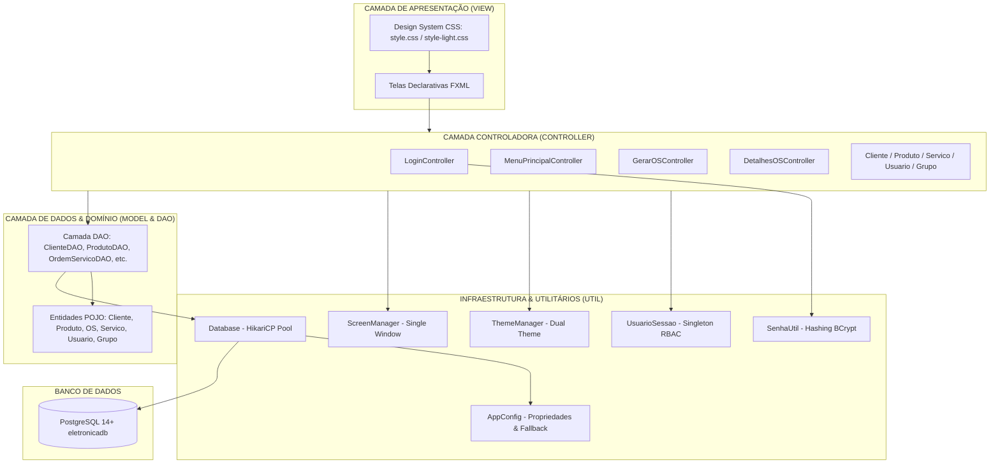
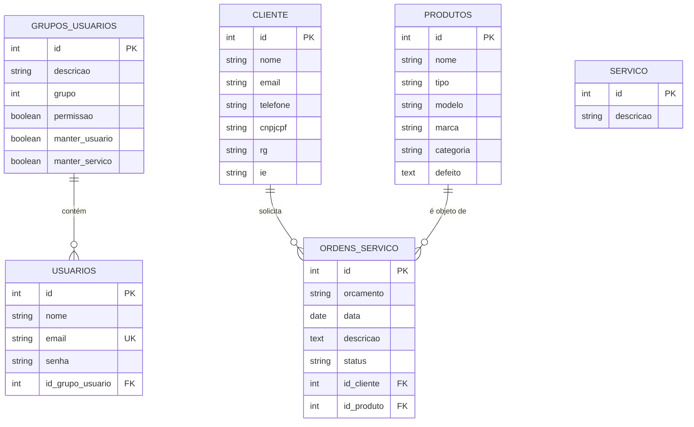

# Eletrônica VA — Sistema de Gestão para Assistência Técnica e Controle de OS

[](https://openjdk.org/)
[](https://openjfx.io/)
[](https://www.postgresql.org/)
[](https://github.com/brettwooldridge/HikariCP)
[](https://www.mindrot.org/projects/jBCrypt/)
[](https://junit.org/junit5/)
[](https://maven.apache.org/)

O **Eletrônica VA (`EletronicaAPP`)** é um sistema desktop moderno, robusto e escalável para **gestão operacional, triagem técnica, controle de clientes, equipamentos e emissão de Ordens de Serviço (OS)** em assistências técnicas e oficinas de eletrônicos em geral.

Desenvolvido segundo as melhores práticas da engenharia de software com arquitetura em camadas (**MVC + DAO + Singleton**), pool de conexões de alta performance (**HikariCP**), segurança de credenciais com criptografia **BCrypt** e interface gráfica moderna com suporte nativo a **Dual Theme (Dark e Light Mode)**.

---

## Índice

- [Destaques da Interface e Experiência do Usuário](#destaques-da-interface-e-experiência-do-usuário)
  - [Dashboard em 3 Colunas](#dashboard-em-3-colunas)
  - [Dual Theme System (Tema Escuro / Tema Claro)](#dual-theme-system-tema-escuro--tema-claro)
  - [Gerenciamento Inteligente de Telas (ScreenManager)](#gerenciamento-inteligente-de-telas-screenmanager)
- [Arquitetura de Software](#arquitetura-de-software)
  - [Padrões Arquiteturais](#padrões-arquiteturais)
  - [Diagrama da Arquitetura](#diagrama-da-arquitetura)
  - [Estrutura do Projeto](#estrutura-do-projeto)
- [Módulos e Casos de Uso (RBAC)](#módulos-e-casos-de-uso-rbac)
  - [Matriz de Permissões](#matriz-de-permissões)
  - [Detalhamento dos Casos de Uso](#detalhamento-dos-casos-de-uso)
- [Segurança e Configuração](#segurança-e-configuração)
  - [Criptografia e Migração Transparente de Senhas](#criptografia-e-migração-transparente-de-senhas)
  - [Hierarquia de Configuração e Pool HikariCP](#hierarquia-de-configuração-e-pool-hikaricp)
- [Banco de Dados e Modelo Entidade-Relacionamento](#banco-de-dados-e-modelo-entidade-relacionamento)
  - [Diagrama ER (Mermaid)](#diagrama-er-mermaid)
  - [Script de Inicialização](#script-de-inicialização)
- [Como Executar o Projeto](#como-executar-o-projeto)
  - [Pré-requisitos](#pré-requisitos)
  - [Passo a Passo de Instalação](#passo-a-passo-de-instalação)
  - [Execução dos Testes Automatizados](#execução-dos-testes-automatizados)
  - [Iniciando a Aplicação](#iniciando-a-aplicação)
  - [Credenciais Padrão de Acesso](#credenciais-padrão-de-acesso)
- [Tecnologias Utilizadas](#tecnologias-utilizadas)
- [Autor e Licença](#autor-e-licença)

---

## Destaques da Interface e Experiência do Usuário

### Dashboard em 3 Colunas

A tela principal (`FrmMenuPrincipal.fxml`) foi projetada como um cockpit operacional dividido ergonomicamente em três seções:

```
+------------------+------------------------------------+-------------------------+
|  SIDEBAR         |  PAINEL CENTRAL                    |  PREVIEW E AÇÕES (OS)   |
|  - Identidade    |  - Saudação, Busca e Alternar Tema |  - Card Destaque "OS"   |
|  - Painel Loja   |  - 4 Cards de Métricas:            |  - Resumo de Diagnóstico|
|    (Capacidade)  |    * Em Espera                     |  - Orçamento e Status   |
|  - Menu Vertical |    * Em Andamento                  |  - Ações Rápidas:       |
|    (Ícones SVG)  |    * Prontos                       |    * Detalhes Completos |
|  - Botão Hero:   |    * Total Registrado              |    * Alterar Status     |
|    Nova OS (UC05)|  - Tabela de Atendimentos Recentes |    * Excluir com Trava  |
|  - Sessão e Sair |                                    |                         |
+------------------+------------------------------------+-------------------------+
```

### Dual Theme System (Tema Escuro / Tema Claro)

* **Alternância Dinâmica em Tempo Real**: Através do botão localizado no cabeçalho do painel principal, o operador alterna entre os modos **Dark** e **Light** instantaneamente, sem necessidade de reiniciar a aplicação.
* **Propagação Global com `ThemeManager`**: Aplica o tema selecionado a todas as janelas ativas e telas filhas, mantendo harmonia cromática em todo o fluxo de trabalho.
* **Tema Escuro (`style.css`)**: Fundos em tons profundos de Slate (`#0b0f19`, `#111827`, `#1f2937`), cartões com efeito *glassmorphism* e tipografia de alto contraste (`#f9fafb`).
* **Tema Claro (`style-light.css`)**: Paleta corporativa luminosa (`#f1f5f9`, `#ffffff`, `#e2e8f0`) com tipografia escura (`#0f172a`), garantindo conforto visual em ambientes bem iluminados.
* **Acentos Funcionais**:
  * 🔵 **Azul (`#3b82f6` / `#2563eb`)**: Ações primárias (Salvar, Pesquisar, Detalhes e Nova OS).
  * 🟡 **Âmbar (`#fbbf24` / `#f59e0b`)**: Ações de limpeza, atalhos de status e ordens *Em Espera*.
  * 🟢 **Verde (`#22c55e` / `#16a34a`)**: Ordens com status *Pronto* e confirmações de sucesso.
  * 🔴 **Vermelho (`#ef4444` / `#dc2626`)**: Ações destrutivas (Excluir) e encerramento de sessão.

### Gerenciamento Inteligente de Telas (ScreenManager)

* **Política de Janela Única**: Ao abrir qualquer tela secundária (Clientes, Produtos, Gerar OS, etc.), qualquer janela anterior é fechada automaticamente, prevenindo sobreposição de janelas, duplicidade de instâncias e perda de foco.
* **Maximização Padrão**: Todas as telas operacionais abrem maximizadas por padrão (`stage.setMaximized(true)`), aproveitando ao máximo a área útil do monitor.
* **Retorno Fluido**: Ao concluir ou cancelar uma operação em tela secundária, o usuário retorna diretamente ao menu principal, com os contadores e a tabela de ordens atualizados em tempo real.

---

## Arquitetura de Software

### Padrões Arquiteturais

O sistema adota padrões consolidados do ecossistema Java corporativo:

1. **MVC (Model-View-Controller)**:
   - **Model**: Entidades POJO (`ClienteEntity`, `ProdutoEntity`, `OrdemServicoEntity`, etc.) com atributos privados, getters/setters, encapsulamento de regras de domínio (ex: enum `TipoStatus`) e sobrescrita de `equals()`, `hashCode()` e `toString()`.
   - **View**: Interfaces declarativas em FXML (`src/main/resources/com/eletronica/view/`) desacopladas da lógica de negócios, estilizadas via CSS3 e ícones vetoriais SVG (`SVGPath`).
   - **Controller**: Mediação entre interface e modelo de dados, tratamento de eventos do usuário, validação de campos e controle de permissões de sessão.
2. **DAO (Data Access Object)**:
   - Isola completamente o código SQL/JDBC (`PreparedStatement`, `ResultSet`, transações) do restante da aplicação.
   - Recursos JDBC gerenciados rigorosamente com `try-with-resources` para evitar vazamento de cursores e conexões.
3. **Singleton**:
   - `UsuarioSessao`: Ponto único de verdade sobre o operador autenticado e suas permissões ativas.
   - `Database`: Gerenciamento centralizado do ciclo de vida do pool de conexões **HikariCP**.
   - `ThemeManager`: Controle de estado do tema ativo e despacho de notificações para ouvintes.
   - `ScreenManager`: Controle centralizado do ciclo de vida das janelas JavaFX.

### Diagrama da Arquitetura



### Estrutura do Projeto

```
EletronicaVA_Java/
├── database/
│   └── schema.sql                            # Script DDL e seeds iniciais do PostgreSQL
├── docs/                                     # Documentações técnicas adicionais
├── context.md                                # Contexto de melhorias técnicas
├── README.md                                 # Documentação principal do repositório
└── EletronicaAPP/                            # Módulo oficial da aplicação Java/Maven
    ├── pom.xml                               # Gerenciamento de dependências e plugins
    ├── application-local.properties.example  # Modelo para credenciais locais de banco
    └── src/
        ├── main/
        │   ├── java/com/eletronica/
        │   │   ├── App.java                  # Ponto de entrada JavaFX e rotinas de inicialização
        │   │   ├── model/                    # Entidades de negócio (POJOs)
        │   │   │   ├── ClienteEntity.java
        │   │   │   ├── GrupoUsuarioEntity.java
        │   │   │   ├── OrdemServicoEntity.java
        │   │   │   ├── ProdutoEntity.java
        │   │   │   ├── ServicoEntity.java
        │   │   │   └── UsuarioEntity.java
        │   │   ├── controller/               # Controladores JavaFX
        │   │   │   ├── LoginController.java
        │   │   │   ├── MenuPrincipalController.java
        │   │   │   ├── GerarOSController.java
        │   │   │   ├── DetalhesOSController.java
        │   │   │   ├── ClienteController.java
        │   │   │   ├── ProdutoController.java
        │   │   │   ├── ServicoController.java
        │   │   │   ├── OrdemServicoController.java
        │   │   │   ├── UsuarioController.java
        │   │   │   └── GrupoUsuarioController.java
        │   │   ├── dao/                      # Camada de Acesso a Dados (JDBC / SQL)
        │   │   │   ├── ClienteDAO.java
        │   │   │   ├── ProdutoDAO.java
        │   │   │   ├── ServicoDAO.java
        │   │   │   ├── OrdemServicoDAO.java
        │   │   │   ├── UsuarioDAO.java
        │   │   │   └── GrupoUsuarioDAO.java
        │   │   └── util/                     # Utilitários, segurança e infraestrutura
        │   │       ├── AppConfig.java        # Leitor hierárquico de configurações
        │   │       ├── Database.java         # Gerenciador de pool HikariCP
        │   │       ├── ScreenManager.java    # Gerenciador de janelas únicas
        │   │       ├── SenhaUtil.java        # Hashing e validação BCrypt
        │   │       ├── ThemeManager.java     # Gerenciador de temas Dark/Light
        │   │       ├── UsuarioSessao.java    # Singleton de sessão do usuário logado
        │   │       └── TesteConexao.java     # Utilitário de diagnóstico de conexão
        │   └── resources/
        │       ├── application.properties    # Configurações padrão da aplicação
        │       ├── simplelogger.properties   # Configuração de logs do SLF4J
        │       └── com/eletronica/view/      # Telas FXML e folhas de estilo CSS
        │           ├── style.css             # Folha de estilo: Tema Escuro
        │           ├── style-light.css       # Folha de estilo: Tema Claro
        │           ├── FrmLogin.fxml
        │           ├── FrmMenuPrincipal.fxml
        │           ├── FrmGerarOS.fxml
        │           ├── FrmDetalhesOS.fxml
        │           ├── FrmCliente.fxml
        │           ├── FrmProduto.fxml
        │           ├── FrmServico.fxml
        │           ├── FrmOrdemServico.fxml
        │           ├── FrmUsuario.fxml
        │           └── FrmGrupoUsuario.fxml
        └── test/java/com/eletronica/         # Suíte de testes automatizados (JUnit 5)
            ├── dao/                          # Testes de integração dos DAOs e fluxo de OS
            ├── util/                         # Testes de BCrypt, HikariCP, Config e Temas
            └── view/                         # Teste de integridade de carregamento de FXMLs
```

---

## Módulos e Casos de Uso (RBAC)

O sistema conta com **Controle de Acesso Baseado em Perfis (Role-Based Access Control - RBAC)**, permitindo parametrização fina das atribuições de cada operador.

### Matriz de Permissões

| Perfil | Nível (`grupo`) | `permissao` | `manter_usuario` | `manter_servico` | Atribuições |
|---|:---:|:---:|:---:|:---:|---|
| **Administrador** | 1 | `true` | `true` | `true` | Acesso irrestrito a todos os cadastros, emissão de OS, gestão de colaboradores e perfis. |
| **Técnico** | 2 | `true` | `false` | `true` | Emissão e atendimento de OS, consulta de clientes/produtos e gestão do catálogo de serviços técnicos. |
| **Recepcionista** | 3 | `true` | `false` | `false` | Triagem de atendimento, cadastro de clientes e aparelhos, abertura de OS e consulta de status. |

### Detalhamento dos Casos de Uso

#### 1. Autenticação e Gestão de Sessão (`LoginController` / `UsuarioSessao`)
- Login através de e-mail corporativo e senha criptografada.
- Carregamento de privilégios em memória no `UsuarioSessao`.
- Bloqueio imediato da memória: o hash da senha é limpo após autenticação.
- Bloqueio dinâmico de botões e atalhos no menu principal de acordo com as permissões do perfil conectado.

#### 2. UC01 — Gestão de Usuários e Perfis (`UsuarioController` / `GrupoUsuarioController`)
- Cadastro, consulta com filtro em tempo real, edição e exclusão de colaboradores.
- Vinculação com perfis de permissão do banco de dados.
- **Trava de Segurança**: Proteção nativa contra autoexclusão do usuário logado na sessão ativa.

#### 3. UC02 — Catálogo de Serviços (`ServicoController`)
- Gerenciamento dos serviços tabelados prestados pela oficina (Troca de Conector, Reparo em Placa, etc.).
- Permissão controlada pela flag `manter_servico`: perfis não autorizados acessam em modo somente-consulta.

#### 4. UC03 — Gestão de Clientes (`ClienteController`)
- Atendimento a Pessoas Físicas e Jurídicas.
- Armazenamento de Nome, E-mail, Telefone, CPF/CNPJ, RG e Inscrição Estadual (IE).
- Busca dinâmica por nome e preenchimento automático para edição em clique simples.

#### 5. UC04 — Gestão de Equipamentos e Produtos (`ProdutoController`)
- Cadastro detalhado do aparelho: Nome, Tipo, Marca, Modelo, Categoria e Defeito/Sintoma relatado pelo cliente.
- Consulta e edição direta com feedback visual.

#### 6. UC05 — Emissão e Triagem de Ordens de Serviço (`GerarOSController` / `FrmGerarOS.fxml`)
- Tela focada na triagem inicial de novos atendimentos.
- Seleção instantânea de Cliente e Equipamento com atalhos inline para cadastro rápido de novo cliente ou aparelho caso não existam.
- Definição de diagnóstico técnico preliminar, orçamento estimado e status inicial automático (`EM_ESPERA`).

#### 7. Consulta e Conclusão de OS (`DetalhesOSController` / `FrmDetalhesOS.fxml`)
- Acionada a partir do botão circular "Detalhes" ou por duplo clique na tabela do menu principal.
- Exibição consolidada dos dados do cliente, aparelho, histórico do problema e orçamento.
- Atualização ágil de status para técnicos autorizados (`EM_ESPERA` ➔ `EM_ANDAMENTO` ➔ `PRONTO`).

#### 8. Central de Ordens de Serviço (`OrdemServicoController` / `FrmOrdemServico.fxml`)
- Painel tabular completo com listagem cronológica, busca por descrição e manutenção geral.

---

## Segurança e Configuração

### Criptografia e Migração Transparente de Senhas

- A classe `SenhaUtil` utiliza o algoritmo **BCrypt** com fator de trabalho (work factor) configurado para proteger contra ataques de dicionário e rainbow tables.
- **Rotina de Migração Automática**: Ao inicializar a aplicação (`App.java`), o método `UsuarioDAO.migrarSenhasTextoPuro()` verifica se existem colaboradores com senhas legadas em texto plano e gera o hash BCrypt automaticamente de forma idempotente, garantindo continuidade operacional sem interrupções.

### Hierarquia de Configuração e Pool HikariCP

As credenciais do banco nunca devem ser fixadas no código-fonte. A classe `AppConfig` resolve os parâmetros de conexão segundo a seguinte ordem de precedência:

```
[1. Propriedades JVM (-Ddb.url, -Ddb.user, -Ddb.password)]
                       ↓ (se ausente)
[2. Variáveis de Ambiente (DB_URL, DB_USER, DB_PASSWORD)]
                       ↓ (se ausente)
[3. Arquivo local EletronicaAPP/application-local.properties] (ignorado no Git)
                       ↓ (se ausente)
[4. Padrões de desenvolvimento em src/main/resources/application.properties]
```

O gerenciamento de conexões é operado pelo pool **HikariCP 5.1.0**, garantindo:
- Reutilização eficiente de conexões com `maximumPoolSize = 10`.
- Timeout de conexão (`connectionTimeout = 10000ms`).
- Liberação imediata ao final de cada instrução via `try-with-resources`.
- Fechamento gracioso do pool no encerramento da aplicação (`App.stop()`).

---

## Banco de Dados e Modelo Entidade-Relacionamento

### Diagrama ER (Mermaid)



### Script de Inicialização

O script completo DDL e DML está localizado em [`database/schema.sql`](database/schema.sql).

---

## Como Executar o Projeto

### Pré-requisitos

* **Java JDK 17 (LTS)** ou superior instalado e configurado nas variáveis de ambiente.
* **Apache Maven 3.8+**.
* **PostgreSQL 14+** instalado e em execução.

---

### Passo a Passo de Instalação

#### 1. Clonar o Repositório
```bash
git clone https://github.com/Joaopf2/EletronicaVA_Java.git
cd EletronicaVA_Java
```

#### 2. Configurar o Banco de Dados PostgreSQL
Acesse o terminal do PostgreSQL (`psql`) e execute o script de criação:

```bash
psql -U postgres -f database/schema.sql
```

Ou execute manualmente via `psql`:

```sql
CREATE DATABASE eletronicadb WITH OWNER = postgres ENCODING = 'UTF8';
\c eletronicadb;
\i database/schema.sql;
```

#### 3. Configurar Credenciais Locais (Opcional)
Se o seu PostgreSQL utilizar usuário ou senha personalizados, crie o arquivo `EletronicaAPP/application-local.properties` (que é automaticamente ignorado pelo Git):

```properties
db.url=jdbc:postgresql://localhost:5432/eletronicadb
db.user=postgres
db.password=sua_senha_aqui
```

---

### Execução dos Testes Automatizados

O projeto possui **30 testes automatizados** com **JUnit 5**, cobrindo autenticação, migração BCrypt, pool HikariCP, operações CRUD, troca dinâmica de temas, controle de janelas com `ScreenManager` e integridade de carregamento de todos os 10 arquivos FXML:

```bash
cd EletronicaAPP
mvn clean test
```

Resultado esperado:
```
[INFO] Results:
[INFO] 
[INFO] Tests run: 30, Failures: 0, Errors: 0, Skipped: 0
[INFO] 
[INFO] BUILD SUCCESS
```

---

### Iniciando a Aplicação

Para iniciar a aplicação diretamente pelo plugin JavaFX:

```bash
cd EletronicaAPP
mvn javafx:run
```

Para compilar e gerar o pacote JAR:

```bash
mvn clean package
```

---

### Credenciais Padrão de Acesso

Ao inicializar o banco através do script [`database/schema.sql`](database/schema.sql), o seguinte usuário administrador é criado:

| Campo | Valor Padrão |
|---|---|
| **E-mail** | `admin@eletronica.com` |
| **Senha** | `admin123` |
| **Perfil** | Administrador (Acesso completo e irrestrito) |

---

## Tecnologias Utilizadas

| Tecnologia | Versão | Finalidade |
|---|---|---|
| **Java** | 17 (LTS) | Linguagem de programação principal |
| **JavaFX** | 17.0.6 | Framework de interface gráfica desktop (FXML + CSS) |
| **PostgreSQL** | 14+ | Sistema Gerenciador de Banco de Dados Relacional |
| **HikariCP** | 5.1.0 | Pool de conexões JDBC de alta performance |
| **jBCrypt** | 0.4 | Criptografia e hashing seguro de senhas |
| **JUnit 5** | 5.10.2 | Suíte para testes unitários e de integração |
| **SLF4J** | 1.7.36 | Abstração e controle de logs de execução |
| **Apache Maven** | 3.8+ | Automação de compilação, dependências e ciclo de vida |

---

## Autor e Licença

Desenvolvido por **João Pedro Freitas** ([@Joaopf2](https://github.com/Joaopf2)).

Distribuído sob a licença acadêmica e profissional para gestão e assistência técnica. Contribuições, sugestões e melhorias são sempre bem-vindas!
